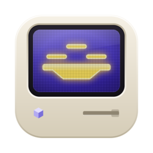
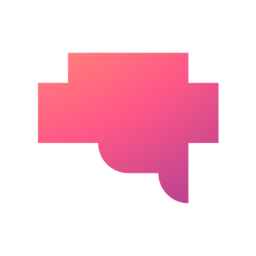
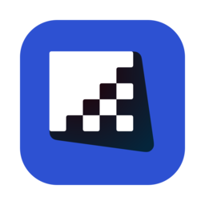

# Hi, I'm Werneck 👋

I'm a **Software Engineer** from **Brazil**.

I use this space to build, experiment, and share projects.
More about me at [mwrnk.dev](https://www.mwrnk.dev).

### Currently building

<a href="https://github.com/Mwrnk/desktop-melee"><picture><source media="(prefers-color-scheme: dark)" srcset="images/desktop-melee-icon-dark.png"></picture></a>

**[Desktop Melee](https://github.com/Mwrnk/desktop-melee)**: Super Smash Bros.
Melee running on your desktop. The fighters stand on your Dock, the screen
edges are the blast zones, and your apps keep working underneath.
In beta for macOS, Windows and Linux.

 

### Other projects

**[Discentia](https://github.com/usediscentia/web-discentia)**: a study app
that runs entirely in your browser. Upload your notes, chat with AI about
them, and turn them into flashcards. [Try it](https://web-discentia.vercel.app).

 

**[Kite](https://github.com/Mwrnk/kite)**: a small, fast, native code editor
for macOS, for people who write code by hand. Built with Swift, AppKit and
tree-sitter, with a minimal look of its own.

 

- **[dock-mario64](https://github.com/Mwrnk/dock-mario64)**: a desktop pet
  that runs and jumps across your Dock and open windows. A technical study in
  Swift and Metal, built on top of [libsm64](https://github.com/libsm64/libsm64).
- **[slick](https://github.com/Mwrnk/slick)**: a real-time chat app in your
  terminal. Bun, Hono, SQLite and WebSockets on the server, Ink for the client.

### What I work with
- **Apple platforms:** Swift, SwiftUI, AppKit, Core Animation
- **Mobile and web:** JavaScript, TypeScript, React Native, Expo
- **Low-level:** C, C++, Metal
- **Design:** UI, icons and motion

Thanks for stopping by!

If something I made made your day better, you can
[buy me a coffee](https://buymeacoffee.com/mwer) ☕
