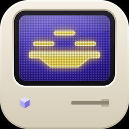

# Hi, I'm Werneck 👋

I'm a **Software Engineer** from **Brazil**.

I use this space to build, experiment, and share projects.

### 🎮 Currently building

<a href="https://github.com/Mwrnk/desktop-melee"><picture><source media="(prefers-color-scheme: dark)" srcset="images/desktop-melee-icon-dark.png"></picture></a>

**[Desktop Melee](https://github.com/Mwrnk/desktop-melee)**: Super Smash Bros.
Melee running on your Mac's desktop. The fighters stand on your Dock, the
screen edges are the blast zones, and your apps keep working underneath.
macOS for now; Windows and Linux are coming soon.

 

### 🛠 What I work with
- **Apple platforms:** Swift, SwiftUI, AppKit, Core Animation
- **Low-level:** C, C++, Metal
- **Design:** UI, icons and motion

Thanks for stopping by!

If something I made made your day better, you can
[buy me a coffee](https://buymeacoffee.com/mwer) ☕
